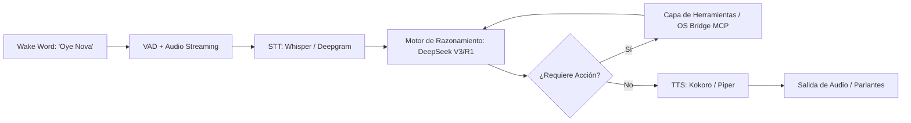

# Nova Workspace — Especificación de Arquitectura de Asistente de Voz Agéntico

## 1. Visión del Sistema
**Nova** es una plataforma de asistencia agéntica por voz de baja latencia con soporte transversal para **Linux**, **macOS** y **Windows**. 

Inspirada en la familiaridad y simplicidad de asistentes como *"Oye, Siri"* (con el comando de activación *"Oye, Nova"*), va más allá de un simple bot reactivo: incorpora un bucle agéntico autónomo que combina razonamiento multi-paso, orquestación de herramientas del sistema operativo mediante MCP (Model Context Protocol) y comunicación por voz bidireccional en tiempo real.

---

## 2. Identidad y Parámetros del Workspace
* **Nombre del Workspace:** `Nova Workspace`
* **ID de Proyecto:** `nova-workspace`
* **Namespace:** `nova`
* **Prefijo de Tickets:** `NOVA`
* **Wake Word:** *"Oye Nova"* / *"Hey Nova"*

---

## 3. Pipeline Arquitectónico

---

## 4. Componentes Principales

### 4.1. Detección de Wake Word y Entrada de Audio
* **Wake Word Engine:** OpenWakeWord o Porcupine afinado para la frase *"Oye Nova"*, ejecutado localmente con consumo despreciable de CPU (<1%).
* **VAD (Voice Activity Detection):** Silero VAD para detectar fin de turno de voz y pausas de forma adaptativa.
* **STT (Speech-to-Text):**
  * *Local:* `faster-whisper` (C++ / cuBLAS / Metal) para total privacidad sin conexión.
  * *Nube:* Deepgram Nova-2 para latencia ultra baja (<200 ms).

### 4.2. Núcleo Agéntico y Razonamiento (Orquestación & LLM)
* **Motor LLM:** DeepSeek (V3 para llamadas rápidas a herramientas; R1 para planificación compleja y auto-corrección).
* **Bucle Agéntico:** Ciclo ReAct (Thought → Action → Observation) con límite de pasos y validación previa a acciones destructivas.
* **Memoria y Contexto:** Gestión de estado de sesión persistente e indexación semántica local de preferencias del usuario.

### 4.3. Capa de Integración con el Sistema Operativo (OS Bridge & MCP)
* **Protocolo:** Integración nativa de servidores MCP (Model Context Protocol).
* **Herramientas Multiplataforma:**
  * Control de ventanas, aplicaciones y foco (Linux vía X11/Wayland, Windows vía Win32, macOS vía AppleScript/Accessibility APIs).
  * Automatización de archivos, portapapeles y ejecución controlada de scripts.

### 4.4. Síntesis de Voz (TTS)
* **Motor Local de Baja Latencia:** Kokoro o Piper TTS para síntesis de voz natural y expresiva sin saltar a la nube.
