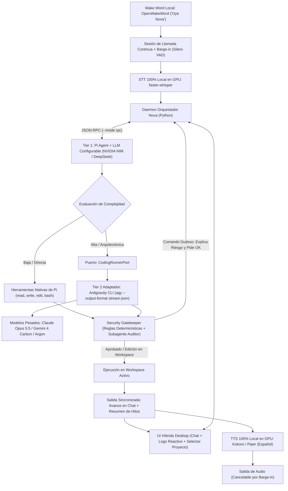

# Nova Voice — Especificación de Arquitectura de Asistente de Voz Agéntico

## 1. Visión del Sistema y Alcance por Fases

**Nova** es una aplicación de asistencia agéntica multimodal (voz y chat) diseñada para el desarrollo de software asistido por voz en tiempo real, inspirada en la inmediatez de *"Oye, Siri"* (*"Oye, Nova"*), pero respaldada por una arquitectura agéntica de dos niveles para planificación, edición de código y ejecución segura en la máquina local.

### Alcance del MVP (Fase 1 — Linux Local)
* Ejecución exclusiva en **Linux** sobre la estación de trabajo local del desarrollador.
* Interfaz de escritorio híbrida: panel de chat en tiempo real combinado con modo de llamada continua y un **logo/orbe reactivo de Nova** (estático en reposo y animado con brillo/pulso al activarse).
* Pipeline de voz **100% local sobre GPU (CUDA)** para garantizar privacidad y costo operativo nulo en audio.
* Orquestación en dos niveles desacoplada mediante **Arquitectura Hexagonal (Ports & Adapters)**: **Pi Agent** en el Tier 1 con proveedores LLM configurables de bajo costo o gratuitos (como **NVIDIA NIM**) y **Antigravity CLI (`agy`)** en el Tier 2 con modelos de razonamiento profundo.
* Selección dual de espacio de trabajo (selector visual de carpetas y resolución por voz) y filtro de seguridad híbrido para comandos de terminal.

### Fuera de Alcance del MVP (Fase 2+)
* Soporte nativo de escritorio para **macOS** y **Windows**.
* Aplicaciones clientes móviles (**Android** e **iOS**).
* Captura de cámara, transmisión de pantalla o avatares 3D.
* Adaptador adicional en el Tier 2 para **OpenCode** (`OpenCodeAdapter`).

---

## 2. Identidad y Parámetros Técnicos Base

* **Nombre del Producto:** `Nova Voice`
* **Repositorio:** `nova-voice`
* **Comando CLI:** `nova`
* **Nombre del Workspace:** `Nova Workspace`
* **ID de Proyecto:** `nova-workspace`
* **Namespace:** `nova`
* **Prefijo de Tickets:** `NOVA`
* **Wake Word:** *"Oye Nova"* / *"Hey Nova"*
* **Lenguaje Base del MVP:** Python (`asyncio` para orquestación de audio, subprocesos RPC/NDJSON e interfaz gráfica).

---

## 3. Pipeline Arquitectónico

---

## 4. Componentes Principales

### 4.1. Interfaz Híbrida y Gestión de Contexto de Proyecto
* **Experiencia Visual y de Llamada:** Ventana de escritorio que combina el historial estructurado del chat con una vista de llamada protagonizada por el **logo de Nova** (sin avatares complejos): permanece estático en espera y reacciona dinámicamente al detectar *"Oye Nova"* reflejando los estados del ciclo (*escuchando*, *pensando*, *ejecutando*, *hablando*).
* **Llamada Abierta con *Barge-in*:** Una vez activada la sesión, el canal permanece abierto sin requerir repetir la palabra de activación en cada turno. Si el usuario habla mientras Nova reproduce audio, el motor cancela inmediatamente la salida TTS y prioriza la nueva entrada.
* **Selección Dual de Proyecto:** El directorio objetivo (`cwd`) sobre el que operan los agentes puede fijarse tanto desde un selector visual en la interfaz como mediante comandos de voz resolviendo contra los directorios locales de desarrollo (por ejemplo, `~/Proyectos`).

### 4.2. Pipeline de Voz 100% Local (Acelerado por GPU)
* **Wake Word Engine:** `OpenWakeWord` ejecutado localmente con consumo mínimo de CPU en reposo.
* **Detección de Actividad de Voz (VAD):** `Silero VAD` para segmentación adaptativa de turnos de habla y disparo inmediato del *barge-in*.
* **Speech-to-Text (STT):** `faster-whisper` ejecutado localmente sobre CUDA para transcripción en español de baja latencia sin costos por minuto ni envío de audio a terceros.
* **Text-to-Speech (TTS):** `Kokoro` o `Piper` local sobre GPU/ONNX para síntesis de voz fluida en español (<200 ms), encargada de conversar, narrar resúmenes de avance y comunicar alertas de seguridad.

### 4.3. Núcleo Agéntico en Dos Niveles (Ports & Adapters)
* **Tier 1 — Conversación, Planificación y Ejecución Ligera (`Pi Agent`):**
  * Ejecutado como proceso persistente mediante `pi --mode rpc` para preservar memoria de sesión, herramientas e historial sin latencia de arranque en frío.
  * **Proveedor LLM Desacoplado:** Configurado mediante los parámetros nativos `--provider` y `--model` de `pi`. Utiliza por defecto el catálogo gratuito/económico de **NVIDIA NIM** (por ejemplo, `nvidia/deepseek-ai/deepseek-v4.1-flash` o `nvidia/nemotron-3.5-lightning-30b-a3b`), manteniendo compatibilidad directa con DeepSeek API u otros proveedores soportados por `pi`.
  * **Responsabilidad:** Dialogar con el desarrollador para aterrizar ideas, estructurar el plan y clasificar la complejidad de cada solicitud. Si la tarea es acotada, `Pi Agent` la resuelve directamente.
* **Tier 2 — Razonamiento Profundo y Ejecución Pesada (`CodingRunnerPort`):**
  * Definido detrás de una interfaz abstracta (`CodingRunnerPort`) siguiendo Arquitectura Hexagonal para permitir futuros adaptadores (como `OpenCodeAdapter` en Fase 2) sin alterar el núcleo.
  * **Adaptador MVP (`AntigravityCLIAdapter`):** Invoca `agy` en modo no interactivo estructurado (`--output-format stream-json`, manteniendo continuidad con `--conversation`) seleccionando modelos de alta capacidad (`claude-opus-5-5-high`, `gemini-4-carbon-high` o `gemini-4-argon-high`).
  * **Progreso Dual:** Mientras `agy` opera, Nova vuelca el detalle técnico en el chat y sintetiza hitos breves por voz para mantener informado al usuario.

### 4.4. Security Gatekeeper en Dos Capas
* **Política de Archivos:** Las operaciones de lectura, creación, modificación y eliminación de archivos **dentro del workspace activo** cuentan con permiso automático.
* **Intercepción de Comandos de Terminal:** Toda ejecución de consola en `pi` o `agy` atraviesa un filtro previo de dos etapas antes de llegar al sistema operativo:
  1. **Capa 1 — Filtro Determinístico (0 ms):** Lista blanca inmediata para comandos locales de inspección y pruebas (`git status`, `pytest`, linters) y bloqueo preventivo obligatorio ante patrones sensibles (`sudo`, ejecución remota encadenada como `curl | sh`, `git push`, modificaciones globales o accesos fuera del directorio del proyecto).
  2. **Capa 2 — Subagente Auditor:** Evalúa comandos ambiguos o retenidos por la Capa 1, pausa la ejecución y notifica al usuario **por voz y en pantalla** explicando qué realiza exactamente el comando y cuál es su impacto, aguardando confirmación explícita (*aprobar* / *rechazar*) antes de continuar.

---

## 5. Presupuesto Técnico y Entorno de Referencia (MVP Linux)

* **Hardware de Referencia:** Estación Linux con CPU multinúcleo, 16 GB de RAM y GPU NVIDIA con al menos 6 GB de VRAM (ej. RTX 3060 Laptop GPU) dedicada exclusivamente al pipeline local de audio (STT + VAD + TTS), delegando la inferencia de LLMs a las APIs configuradas en `pi` y `agy`.
* **Aislamiento y Seguridad:** Ninguna credencial (`NVIDIA_API_KEY`, `DEEPSEEK_API_KEY`, sesiones de `agy`) se almacena en el código fuente ni en artefactos del repositorio; el sistema consume exclusivamente las credenciales gestionadas por el entorno del usuario y los llaveros nativos de cada CLI.

