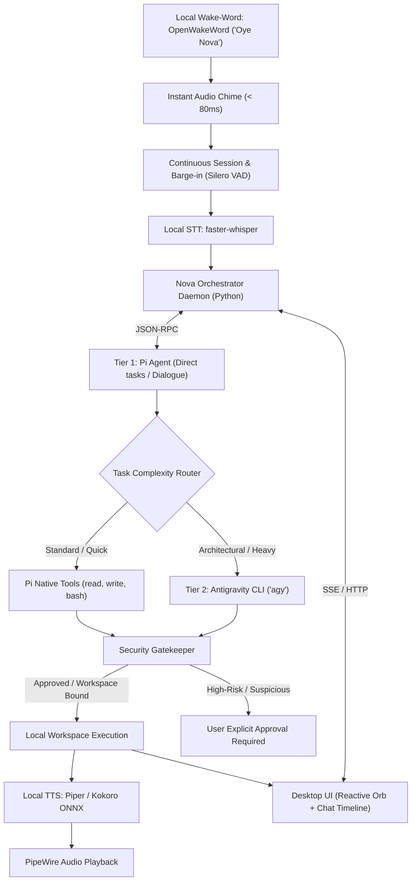
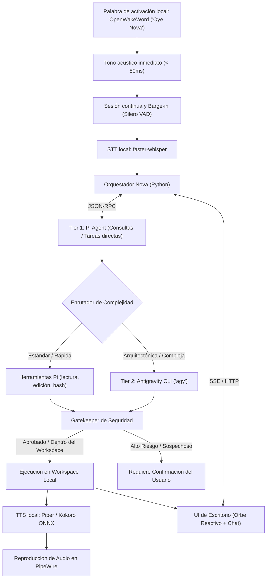

# Nova Voice

[English](#english) | [Español](#español)

---

<a name="english"></a>
## English

Nova Voice is an open-source, local-first multimodal (voice and chat) agentic assistant for Linux, built specifically for hands-free and accelerated software development. It combines wake-word activation, continuous low-latency voice dialogue, and a two-tier agentic architecture to plan, edit code, and safely execute workflows on your local machine.

### Key Features

- **100% Local Voice Pipeline (Zero Cloud Audio Cost)**:
  - Wake-word engine powered by `openwakeword` (*"Oye Nova"* / *"Hey Nova"*).
  - Instant earcon audio chime (< 80 ms) for immediate acoustic feedback upon detection or Push-to-Talk activation.
  - Continuous conversation and barge-in interruption via `silero-vad`.
  - Local GPU/CPU Speech-to-Text (STT) via `faster-whisper`.
  - Local Text-to-Speech (TTS) synthesis via `piper` and `kokoro-onnx`.
  - PipeWire and PulseAudio native playback and capture with acoustic anti-echo filtering.

- **Two-Tier Agentic Architecture**:
  - **Tier 1 (Fast & Interactive)**: Pi Agent handles direct questions, quick terminal tasks, conversational dialogues, and file inspections. Conversational queries run freely without requiring an active project workspace.
  - **Tier 2 (Deep Reasoning & Coding)**: Antigravity CLI (`agy`) runs advanced reasoning models (e.g., Claude 3.7 / Opus, Gemini Pro) for multi-file architecture refactoring, complex bug repairs, and test suites.

- **Security Gatekeeper**:
  - Dual-layer protection (deterministic rules + auditor) guarding the workspace against destructive bash commands, unapproved file overwrites, and secret exposure.

- **Preflight Component Health Diagnostics**:
  - Validates required tools (`pi`, `agy`, `pw-record`, `pw-play`) and local ONNX voice models at launch.
  - Reports missing dependencies to `stderr`, exposes `GET /api/health`, and renders an accessible alert banner in the UI with resolution steps.

- **Desktop UI**:
  - Built-in web interface with GNOME styling tokens, reactive animated squircle orb (status states: Standby, Listening, Thinking, Speaking), live SSE telemetry, settings drawer, and WCAG 2.1 AA accessibility.

---

### Architecture Overview



---

### Prerequisites

- **Operating System**: Linux (Ubuntu 22.04+, Debian 12+, Fedora 38+, Arch Linux).
- **Audio Subsystem**: PipeWire with `pw-record` / `pw-play`, or PulseAudio with `parecord` / `paplay`.
- **Python**: Version 3.11 or higher.
- **Node.js**: Version 18 or higher (for building the UI).
- **Agent CLI Tools** (optional but recommended):
  - Tier 1: `pi` (located in PATH or `~/.local/bin/pi`).
  - Tier 2: `agy` (Antigravity CLI in PATH or `~/.local/bin/agy`).

---

### Installation

#### Option 1: Debian Package (.deb)

If you have a built `.deb` release package:

```bash
sudo apt install --reinstall ./dist/nova-voice_0.1.0_amd64.deb
```

This installs `nova` and `nova-desktop` into `/opt/nova/` with symlinks in `/usr/local/bin/`, installs desktop application launchers, and sets up system model paths.

#### Option 2: From Source (Development)

1. Clone the repository:
   ```bash
   git clone https://github.com/GabrielCruzSoto/nova-voice.git
   cd nova-voice
   ```

2. Create and activate a Python virtual environment:
   ```bash
   python3 -m venv .venv
   source .venv/bin/activate
   pip install --upgrade pip
   pip install -e ".[dev,voice]"
   ```

3. Install UI dependencies and build the frontend assets:
   ```bash
   npm install
   npm run build:ui
   ```

---

### Model Directory Setup

Nova resolves voice models according to the following precedence order:
1. Explicit CLI arguments (e.g. `--piper-model`).
2. `--models-dir <path>` CLI option.
3. `NOVA_MODELS_DIR` environment variable.
4. User directory: `~/.local/share/nova/models` or `$XDG_DATA_HOME/nova/models`.
5. Global system installation: `/opt/nova/models`.
6. Source checkout: `<repo_root>/models`.

Recommended models for full voice support:
- `oye_nova.onnx` (Wake word)
- `melspectrogram.onnx` & `embedding_model.onnx` (OpenWakeWord feature extraction)
- `silero_vad.onnx` (Voice activity detection)
- `es_ES-davefx-medium.onnx` & `.json` (Piper TTS Spanish)

---

### Usage

Run Nova with default desktop UI:
```bash
nova-desktop
```

Or run directly through the Python entrypoint:
```bash
./nova-desktop [OPTIONS]
```

#### Common CLI Options

| Option | Description |
|---|---|
| `--no-voice` | Starts Nova in text/chat-only mode (bypasses microphone/speaker pipeline). |
| `--port <int>` | Port for the local UI HTTP/SSE server (default: random free port). |
| `--host <str>` | Bind address (default: `127.0.0.1`). |
| `--models-dir <path>` | Custom directory containing ONNX voice models. |
| `--tier1-agent <name>` | Tier 1 CLI tool (default: `pi`). |
| `--tier2-agent <name>` | Tier 2 CLI tool (default: `agy`). |
| `--ptt-mode <mode>` | Push-to-Talk activation mode (`hold`, `toggle`, or `disabled`). |

---

### Verification and Tests

Run the full Python test suite:
```bash
pytest tests/ -q
```

Run the UI suite:
```bash
npm run test:ui
```

Build a standalone Debian release package:
```bash
./packaging/deb/build.sh --mode release
```

---

<a name="español"></a>
## Español

Nova Voice es un asistente agéntico multimodal (voz y chat) local para Linux, diseñado específicamente para optimizar y acelerar el desarrollo de software con manos libres. Combina detección de palabra de activación, diálogo de voz continuo de baja latencia y una arquitectura agéntica de dos niveles para planificar, modificar código y ejecutar tareas de forma segura en la estación de trabajo local.

### Características Principales

- **Pipeline de Voz 100% Local (Sin Costos de Audio en la Nube)**:
  - Motor de palabra de activación con `openwakeword` (*"Oye Nova"* / *"Hey Nova"*).
  - Feedback acústico inmediato mediante tono doble (*earcon* de < 80 ms) al detectar la palabra clave o activar Push-to-Talk.
  - Conversación continua y cancelación por interrupción (*barge-in*) con `silero-vad`.
  - Reconocimiento de voz local en GPU o CPU mediante `faster-whisper`.
  - Síntesis de voz (TTS) local mediante `piper` y `kokoro-onnx`.
  - Captura y reproducción nativa en PipeWire y PulseAudio con ventana de protección contra eco.

- **Arquitectura Agéntica en Dos Niveles**:
  - **Tier 1 (Rápido e Interactivo)**: Pi Agent gestiona preguntas directas, comandos breves de terminal, diálogo general e inspección de archivos. Permite consultas informativas sin necesidad de tener un espacio de trabajo seleccionado.
  - **Tier 2 (Razonamiento y Código Complejo)**: Antigravity CLI (`agy`) utiliza modelos avanzados de razonamiento para refactorizaciones de arquitectura, corrección profunda de errores y suites de pruebas en múltiples archivos.

- **Gatekeeper de Seguridad**:
  - Protección de doble nivel (reglas deterministas + auditor) que previene la ejecución accidental de comandos destructivos en la terminal o la fuga de credenciales.

- **Diagnóstico Preventivo de Componentes**:
  - Comprobación automática de ejecutables del sistema (`pi`, `agy`, utilidades PipeWire) y modelos ONNX locales al arrancar.
  - Notificación en `stderr`, endpoint REST `GET /api/health` y banner visual accesible en la interfaz con instrucciones de resolución.

- **Interfaz de Escritorio**:
  - UI web integrada con diseño GNOME, orbe reactivo con animaciones de estado (En espera, Escuchando, Procesando, Hablando), telemetría en tiempo real por SSE, panel de ajustes y accesibilidad WCAG 2.1 AA.

---

### Diagrama de Arquitectura



---

### Requisitos del Sistema

- **Sistema Operativo**: Linux (Ubuntu 22.04+, Debian 12+, Fedora 38+, Arch Linux).
- **Subsistema de Audio**: PipeWire con `pw-record` y `pw-play`, o PulseAudio con `parecord` y `paplay`.
- **Python**: Versión 3.11 o superior.
- **Node.js**: Versión 18 o superior (para compilación de la interfaz).
- **Herramientas CLI de Agentes** (opcionales pero recomendadas):
  - Tier 1: `pi` (en el PATH o en `~/.local/bin/pi`).
  - Tier 2: `agy` (Antigravity CLI en el PATH o en `~/.local/bin/agy`).

---

### Instalación

#### Opción 1: Paquete Debian (.deb)

Si dispone del paquete compilado:

```bash
sudo apt install --reinstall ./dist/nova-voice_0.1.0_amd64.deb
```

Instala Nova en `/opt/nova/`, configura enlaces simbólicos en `/usr/local/bin/`, registra el archivo `.desktop` y establece los directorios de modelos del sistema.

#### Opción 2: Desde el Código Fuente

1. Clonar el repositorio:
   ```bash
   git clone https://github.com/GabrielCruzSoto/nova-voice.git
   cd nova-voice
   ```

2. Crear y activar el entorno virtual de Python:
   ```bash
   python3 -m venv .venv
   source .venv/bin/activate
   pip install --upgrade pip
   pip install -e ".[dev,voice]"
   ```

3. Instalar dependencias de UI y compilar los recursos:
   ```bash
   npm install
   npm run build:ui
   ```

---

### Configuración de Modelos Locales

Nova busca los modelos de IA siguiendo este orden de precedencia:
1. Parámetros explícitos por CLI (por ejemplo `--piper-model`).
2. Opción `--models-dir <ruta>`.
3. Variable de entorno `NOVA_MODELS_DIR`.
4. Directorio de usuario: `~/.local/share/nova/models` o `$XDG_DATA_HOME/nova/models`.
5. Instalación global del sistema: `/opt/nova/models`.
6. Repositorio de desarrollo: `<raiz_del_repo>/models`.

Modelos recomendados:
- `oye_nova.onnx` (Palabra de activación)
- `melspectrogram.onnx` y `embedding_model.onnx` (Extracción de características para OpenWakeWord)
- `silero_vad.onnx` (Detección de actividad vocal)
- `es_ES-davefx-medium.onnx` y `.json` (Síntesis de voz en español)

---

### Uso

Para iniciar Nova con la interfaz gráfica por defecto:
```bash
nova-desktop
```

O ejecutarlo directamente desde el script del proyecto:
```bash
./nova-desktop [OPCIONES]
```

#### Opciones Principales de la Línea de Comandos

| Opción | Descripción |
|---|---|
| `--no-voice` | Inicia Nova únicamente en modo texto/chat (sin capturar micrófono ni altavoces). |
| `--port <int>` | Puerto para el servidor web/SSE local (por defecto: puerto libre aleatorio). |
| `--host <str>` | Dirección de enlace (por defecto: `127.0.0.1`). |
| `--models-dir <ruta>` | Directorio personalizado que contiene los modelos ONNX. |
| `--tier1-agent <nombre>` | Ejecutable para Tier 1 (por defecto: `pi`). |
| `--tier2-agent <nombre>` | Ejecutable para Tier 2 (por defecto: `agy`). |
| `--ptt-mode <modo>` | Modo de activación Push-to-Talk (`hold`, `toggle` o `disabled`). |

---

### Pruebas y Control de Calidad

Ejecutar las pruebas unitarias y de integración en Python:
```bash
pytest tests/ -q
```

Ejecutar las pruebas de la interfaz de usuario:
```bash
npm run test:ui
```

Generar el paquete Debian para distribución:
```bash
./packaging/deb/build.sh --mode release
```

---

### Licencia

Este proyecto se distribuye bajo los términos de la licencia [MIT](LICENSE).
